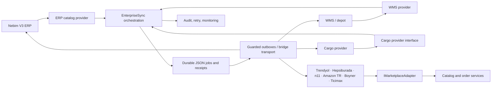
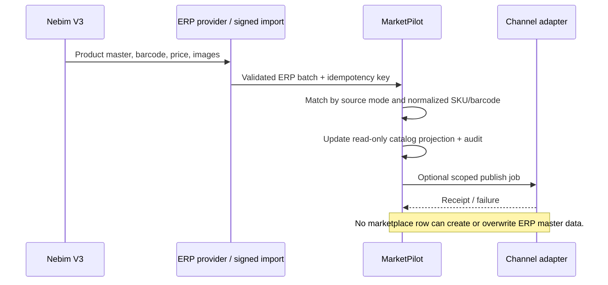
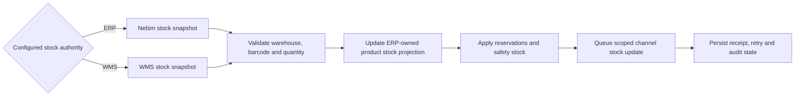

# MarketPilot integration architecture

## Purpose and scope

MarketPilot is an integration and orchestration layer between Nebim V3, a warehouse management system (WMS), and sales channels. It is not the product-master authoring system. This implementation keeps the existing JSON demo store and mock fixtures; it adds no database, credentials, or live vendor connections.

## Current module inventory

| Area | Existing implementation | Responsibility |
|---|---|---|
| Web/API composition | `src/MarketPilot.Web/Program.cs` | ASP.NET Core endpoints, local demo store, application composition |
| Marketplace contracts and adapters | `src/MarketPilot.Web/Integrations/Contracts.cs`, `Integrations/*` | Marketplace read adapters; `IMarketplaceAdapter` is the channel-facing provider contract |
| Shared catalog | `src/MarketPilot.Web/Catalog/*` | ERP master read model, channel listing identity, mapping, category bindings, publish preview/outbox |
| ERP and orchestration | `src/MarketPilot.Web/Enterprise/*` | Signed ERP import, versioned bridge transport, plan, scheduling, persistent jobs, receipts, retry |
| Stock and operations | `src/MarketPilot.Web/Integrations/CentralStock/*`, `src/MarketPilot.Web/Workspace/*`, `src/MarketPilot.Web/Synchronization/*` | Demo stock sources, reservations, order lifecycle, outbox, operational state |
| Asynchronous events | `src/MarketPilot.Web/Webhooks/*` | Webhook inbox and idempotent event handling |
| Persistence | `src/MarketPilot.Web/Program.cs`, `src/MarketPilot.Web/Data/` | JSON-backed demo and operational state; no production database adapter |
| Regression checks | `tests/*checks.cjs`, `tests/MarketPilot.*Checks/` | HTTP/browser checks and isolated domain tests with local fixtures |

## Ownership rules and addressed gaps

| Data | Authoritative owner | MarketPilot behavior |
|---|---|---|
| Product identity, barcode, SKU, category, brand, description, price and product images | Nebim V3 | Read-only catalog. Only the authenticated ERP import or ERP provider can update master data. |
| Available stock and reservations | WMS/depot when selected; otherwise Nebim V3 | Source reads update the master stock projection; marketplace writes go through the existing guarded outbox. Local product/stock mutations are rejected. |
| Marketplace listing, channel identifiers, channel stock/price observations | Individual marketplace | Kept as listing/observation data; it cannot create or change ERP master products. |
| Marketplace order | Marketplace | Imported through the order synchronization path and routed through ERP/WMS job queues. |
| Picking, packing, dispatch and cargo tracking | WMS/depot and configured cargo provider | Validated against the originating order and channel source before status propagation. |
| Audit, mappings, queue state, idempotency receipts and retry | MarketPilot | Persisted in the existing JSON demo store; no vendor system becomes a second writer. |

The following ownership leaks were present and are now closed:

- The unused `CatalogHub.Create` operation and its request model could create a non-ERP master product.
- Catalog bootstrap/import could construct a master product from marketplace rows. Unmatched listings now fail with `master_missing` and must first be present in the ERP catalog.
- Product edits and barcode edits were permitted for records without the ERP source marker. Product, price, barcode, and local stock write routes now reject direct mutation consistently.
- Demo seed rows did not identify their owner. Built-in apparel fixtures are now explicitly tagged as mock Nebim-owned data; known existing fixtures are adopted without deleting them.
- Unmatched legacy rows are retained and marked `unassigned`, but excluded from the ERP-owned catalog, exports, and order-to-product mapping until the ERP import reconciles them.
- `wms-orders` could queue independently of ERP acceptance, and the same plan could enable both paths. Integrated/standalone/disabled WMS modes are explicit; standalone WMS only receives an order after its matching ERP job is completed.

## Layers and provider boundaries



`IErpCatalogProvider`, `IWmsProvider`, and `ICargoProvider` isolate orchestration from source-specific reads. Their current implementations adapt the existing versioned `EnterpriseBridge` contract; they are not vendor-native Nebim, WMS, or carrier clients. A standalone WMS and a Nebim-integrated WMS use the same normalized boundary, with configuration controlling routing. Marketplace reads continue to use `IMarketplaceAdapter`; guarded writes remain on the existing outbox path.

## Data flows

### Product catalog and price



### Order, WMS, and cargo

```mermaid
sequenceDiagram
    participant MP as Marketplace
    participant M as MarketPilot
    participant ERP as Nebim V3
    participant W as WMS / depot
    participant K as Cargo provider
    MP->>M: Order snapshot / webhook
    M->>M: Deduplicate, map SKU/barcode, enqueue ERP job
    M->>ERP: Order with idempotency key
    ERP-->>M: Accepted receipt
    alt Standalone WMS
        M->>W: Forward order only after ERP receipt
    else Nebim-integrated WMS
        Note over ERP,W: ERP-owned internal WMS handoff; no duplicate WMS order write
    end
    W-->>M: Pick/pack/dispatch and packed barcode quantities
    M->>M: Validate dispatch against original order
    M->>K: Create shipment only after valid WMS package confirmation
    K-->>M: Tracking, status and safe label URL
    M->>MP: Queue marketplace shipment update
```

### Stock projection and channel publishing



## WMS topology and safety defaults

- `disabled` is the default WMS topology.
- `nebim-integrated` represents WMS functions owned/routed by Nebim; duplicate standalone `wms-orders` is rejected.
- `standalone` represents a separate WMS. `wms-orders` only queues an order with a completed ERP acceptance job for the same order, store, and source identity.
- WMS stock is only selectable when the WMS topology is enabled. WMS stock schedules are rejected if ERP owns stock.
- New plans start disabled, with no selected stores and all schedules off. Bridge writes and demo exchange remain independently guarded by server-side configuration.
- Local demo orders remain available as fixtures, but no longer decrement ERP-owned product stock. Marketplace order status and shipment mutations are accepted only from the configured WMS/cargo flow.

## Deferred backlog and risks

1. Define and approve the actual Nebim V3, WMS, cargo, and marketplace contracts, mappings, ownership semantics, retry rules, and idempotency behavior with system owners.
2. Implement vendor-native providers behind the interfaces, then certify against non-production systems. No live connector is included here.
3. Decide the deployment secret store, network policy, TLS/mTLS, credential rotation, tenant isolation, and monitoring/alerting model.
4. Move operational persistence from JSON to a transactional store before multi-instance or production deployment; JSON is retained only for the requested demo scope.
5. Add end-to-end reconciliation and contract tests against approved fixtures before enabling writes.
6. Reconcile any historical local stock adjustments against the next authoritative ERP/WMS snapshot; the migration does not guess or silently rewrite balances.

No product or order data was sent to external systems as part of this change.
