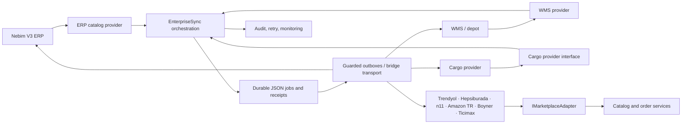
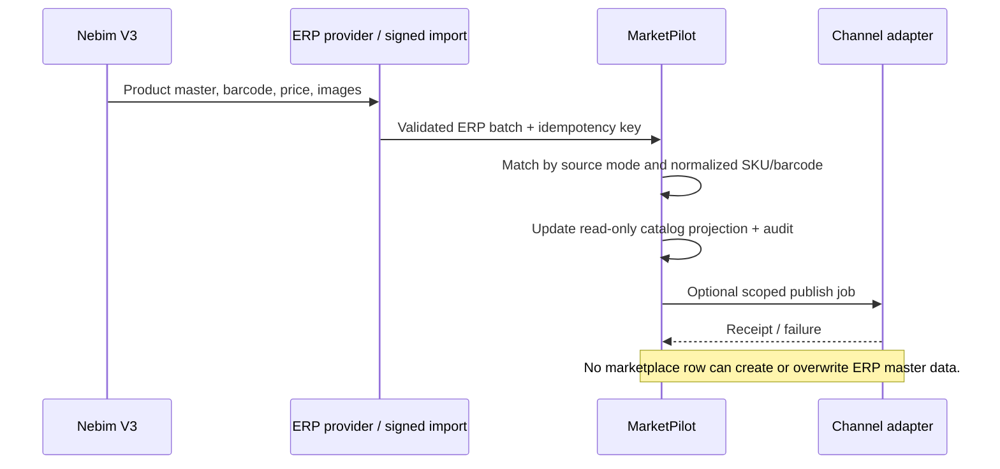
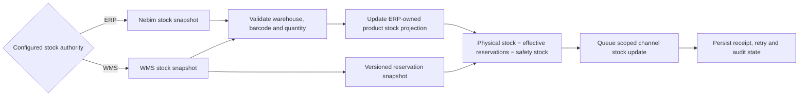

# MarketPilot integration architecture

## Purpose and scope

MarketPilot is an integration and orchestration layer between Nebim V3, a warehouse management system (WMS), and sales channels. It is not the product-master authoring system. This implementation keeps the existing JSON demo store and mock fixtures; it adds no database, credentials, or live vendor connections.

## Current module inventory

| Area | Existing implementation | Responsibility |
|---|---|---|
| Web/API composition | `src/MarketPilot.Web/Program.cs` | ASP.NET Core endpoints, local demo store, application composition |
| Marketplace contracts and adapters | `src/MarketPilot.Web/Integrations/Contracts.cs`, `Integrations/*` | Marketplace read adapters; `IMarketplaceAdapter` is the channel-facing provider contract |
| Shared catalog | `src/MarketPilot.Web/Catalog/*` | ERP master read model, channel listing identity, mapping, category bindings, publish preview/outbox |
| ERP and orchestration | `src/MarketPilot.Web/Enterprise/*` | Signed ERP import, versioned bridge transport, plan, scheduling, persistent jobs, receipts, retry |
| Stock and operations | `src/MarketPilot.Web/Integrations/CentralStock/*`, `src/MarketPilot.Web/Workspace/*`, `src/MarketPilot.Web/Synchronization/*` | Demo stock sources, reservations, order lifecycle, outbox, operational state |
| Asynchronous events | `src/MarketPilot.Web/Webhooks/*` | Webhook inbox and idempotent event handling |
| Persistence | `src/MarketPilot.Web/Program.cs`, `src/MarketPilot.Web/Data/` | JSON-backed demo and operational state; no production database adapter |
| Regression checks | `tests/*checks.cjs`, `tests/MarketPilot.*Checks/` | HTTP/browser checks and isolated domain tests with local fixtures |

## Durable delivery and recovery

The existing stores remain the execution queues; no parallel queue or duplicate worker was added. `EnterpriseSync` owns ERP/WMS integration events, `StockOutbox` owns marketplace stock writes, and the webhook inbox owns inbound order events. Enterprise jobs that reference a native stock-outbox job are tracking records only; they do not submit a second marketplace write.

All paths assume at-least-once delivery. Stable event/request identities deduplicate replays; replaying the same identity with different content is rejected. Webhook application and ERP/WMS transfer operations retain their existing stale-version checks. A webhook event interrupted before its inbox acknowledgement is safe to replay.

| Queue | Durable file | Backpressure / retry behavior | Ambiguous external write |
|---|---|---|---|
| ERP/WMS event jobs | `Data/enterprise-sync.json` | 5,000 active / 10,000 total records; one job per store per worker cycle; ERP bridge writes capped at 8 attempts | Recovered `sending` jobs become `uncertain`. ERP retries query the target by source identity first; WMS submissions use a stable idempotency key and query acceptance after uncertainty, never resending blindly. Exhausted writes require operator intervention; manual recovery resumes with receipt lookup. |
| Marketplace stock outbox | `Data/marketplace-outbox.json` | 5,000 active jobs; one outbound attempt per store per second; exponential backoff with jitter and an 8-attempt ceiling, including safe pre-write retries | 408, 5xx, timeout, connection loss, and interrupted sends are verified by reading target stock. If it cannot be verified, the job remains `uncertain` and is never blindly resent. |
| Order webhook inbox | `Data/order-webhook-inbox.json` | 10,000 events / 32 MiB; exponential backoff with jitter, then `failed` dead-letter after 8 processing attempts | Processing is idempotent; stale events are ignored, and failed events can be retried by an operator. |

HTTP 429 responses preserve `Retry-After` (delta or date) and defer the next attempt accordingly. Marketplace 500/502/503/504 responses are treated as uncertain writes, not as permission to resend. `failed`/`blocked` outbox jobs and failed inbox events are visible in status and support the existing authenticated retry actions. Interrupted ERP/WMS submissions recover into query-only reconciliation before workers resume; a replay does not create another queue or bypass idempotency.

## Ownership rules and addressed gaps

| Data | Authoritative owner | MarketPilot behavior |
|---|---|---|
| Product identity, barcode, SKU, category, brand, description, price and product images | Nebim V3 | Read-only catalog. Only the authenticated ERP import or ERP provider can update master data. |
| Available stock and reservations | WMS/depot when selected; otherwise Nebim V3 | Source reads update the master stock projection; marketplace writes go through the existing guarded outbox. Local product/stock mutations are rejected. |
| Marketplace listing, channel identifiers, channel stock/price observations | Individual marketplace | Kept as listing/observation data; it cannot create or change ERP master products. |
| Marketplace order | Marketplace | Imported through the order synchronization path and routed through ERP/WMS job queues. |
| Picking, packing, dispatch and cargo tracking | WMS/depot and configured cargo provider | Validated against the originating order and channel source before status propagation. |
| Audit, mappings, queue state, idempotency receipts and retry | MarketPilot | Persisted in the existing JSON demo store; no vendor system becomes a second writer. |

### Field-level ownership and synchronization contract

The executable catalogue is `DataOwnershipPolicy.All`; its `OwnershipField`, `SourceSystem`, `SyncDirection`, and `ConflictResolution` values describe the rules below. A source may be a reader without being a writer. `ExternalReference` carries entity identity, source revision/time, observation time, content hash, and optional warehouse. Product imports and WMS stock updates resolve ownership and ordering before mutating the JSON projection.

| Field | Authority | Readers | Writers | Direction | Conflict policy | Version / source time | Duplicate event | Missing data | User-visible state |
|---|---|---|---|---|---|---|---|---|---|
| Product card | Nebim V3 | ERP, MarketPilot, WMS, marketplaces | Nebim V3 | ERP → MarketPilot → marketplaces | ERP wins; non-ERP write is rejected | ERP source version, then source time | Same source content is a no-op | Omitted attributes preserve existing values; no marketplace-created master | ERP received / source update pending |
| Variant | Nebim V3 | ERP, MarketPilot, WMS, marketplaces | Nebim V3 | ERP → MarketPilot → marketplaces | ERP wins; ambiguous identity is blocked | Variant identity + ERP revision/time | Variant external identity and hash | Missing variant does not delete a known variant | ERP variant mapped / mapping pending |
| Barcode | Nebim V3 | ERP, MarketPilot, WMS, marketplaces | Nebim V3 | ERP → MarketPilot → marketplaces | Duplicate identity blocks the full batch | ERP product/variant identity + revision/time | Same identity/hash is a no-op | Missing/blank barcode is rejected | Validated / collision blocked |
| SKU | Nebim V3 | ERP, MarketPilot, WMS, marketplaces | Nebim V3 | ERP → MarketPilot → marketplaces | Duplicate identity blocks the full batch | ERP product/variant identity + revision/time | Same identity/hash is a no-op | Missing/blank SKU is rejected | Validated / collision blocked |
| Category | Nebim V3 | ERP, MarketPilot, WMS, marketplaces | Nebim V3 | ERP → MarketPilot → marketplace category mapping | ERP wins; channel category is a separate mapping | ERP source revision/time | Same source revision/hash is a no-op | Missing category preserves master data | ERP category received / channel mapping pending |
| Brand | Nebim V3 | ERP, MarketPilot, WMS, marketplaces | Nebim V3 | ERP → MarketPilot → marketplaces | ERP wins | ERP source revision/time | Same source revision/hash is a no-op | Missing brand preserves master data | ERP brand received |
| Price | Nebim V3 | ERP, MarketPilot, WMS, marketplaces | Nebim V3 | ERP price list → MarketPilot → marketplaces | ERP wins; currency/list mismatch blocks publishing | Price-list identity + ERP revision/time | Same amount, currency, VAT and revision is a no-op | Null price is unknown; invalid/missing currency is rejected; VAT remains nullable and is never inferred | Received / price, currency or VAT unknown |
| Physical stock | Explicit plan setting: Nebim V3 **or** WMS | ERP, WMS, MarketPilot, marketplaces | Only the configured authority | Configured source → MarketPilot → marketplaces | Configured authority wins, never arrival order; changing authority requires an explicit plan and fresh source snapshot | Authority + warehouse + source revision/time | Same source/hash is a no-op | `NotProvided` preserves; `Unknown` clears knownness; `Known(0)` is zero | Source known / unknown / conflict blocked |
| Reservation | WMS (including WMS functions integrated with Nebim) | WMS, ERP, MarketPilot | WMS or Nebim-routed integrated WMS | WMS → MarketPilot | WMS reservation identity/status wins; conflicting reservation identity blocks | Warehouse + barcode + source revision/time | Same content replay is idempotent; same revision with changed content blocks | Missing row preserves the previous balance; explicit unknown does not become zero | Known / unknown / conflict blocked |
| Sellable stock | MarketPilot-derived | MarketPilot, ERP, WMS, marketplaces | MarketPilot only | Physical stock − effective reservations − configured safety stock → marketplace | Recalculate from configured owners; unknown inputs remain unknown | Input stock and reservation revisions + plan safety-stock value | Same inputs/revisions/policy produce no-op | Any required unknown input blocks calculation/publish | Calculated / source incomplete / publish pending |
| Order | Marketplace owns the incoming order; ERP owns its sales-order document | Marketplace, MarketPilot, ERP, WMS | Marketplace source; ERP accepts sales order; standalone WMS only after ERP acceptance | Marketplace → MarketPilot → ERP → standalone WMS (or ERP-integrated WMS) | Idempotent by account/order/event; conflicting or unmapped lines block | Marketplace external order ID + source revision/time; ERP acceptance receipt | Replayed event is acknowledged once | Missing identity/lines/mapping blocks; does not delete order | Received / ERP pending / WMS ready / blocked |
| Shipment | WMS owns package and dispatch; cargo provider owns carrier tracking facts | WMS, cargo, MarketPilot, marketplaces | WMS package/dispatch; cargo tracking update | WMS → MarketPilot → cargo → marketplace | Validate package against order; cargo updates require ordered source time; conflict blocks | Order/package ID + WMS/cargo revision/time | Package and shipment IDs are idempotency keys | No valid WMS package means no cargo creation | Packing / tracking pending / blocked |
| Return | Marketplace owns the return request; ERP owns financial return/credit; WMS owns physical receipt/inspection | Marketplace, ERP, WMS, MarketPilot | Marketplace request, ERP financial document, WMS receipt/inspection | Marketplace → ERP → WMS → MarketPilot | Separate request, financial acceptance, and physical receipt; mismatch blocks | Return ID + each system's revision/time | Return/event ID is idempotent; stock receipt is a separate event | Missing acceptance or inspection never increases stock | Requested / inspection pending / ERP approval pending |
| Invoice | Nebim V3 owns the official commercial document | ERP, MarketPilot, marketplace | Nebim V3; marketplace only for its external invoice reference | ERP → MarketPilot → marketplace | ERP document identity wins; amount/currency/VAT mismatch blocks | ERP invoice ID/number + revision/time | ERP invoice ID + order/return idempotency key | Missing financial/tax fields remain unknown; no generated defaults | Received / fields incomplete / order match pending |

`StockValue` represents `NotProvided`, `Unknown`, and `Known` independently; `Known(0)` is never treated as missing. Existing `StockKnown` and numeric `Stock` are kept synchronized for legacy readers. For new source messages, an omitted `Inventory` field preserves the legacy interpretation, while callers can explicitly send `NotProvided`, `Unknown`, or `Known(quantity)`.

WMS reservation snapshots are read through `IWmsProvider` and applied only for the configured standalone or Nebim-integrated topology. A snapshot must identify the configured warehouse and an unambiguous ERP barcode; its source revision/time and content hash are retained in `ExternalReference`. Older snapshots, same-revision conflicts, unordered changes, and wrong-warehouse rows block the complete update. Duplicate content is idempotent. A missing barcode row does not clear or zero an existing reservation. An explicit null reservation quantity sets reservation state to `Unknown`, while a known quantity of zero remains a valid balance. Sellable stock is exposed as unknown until physical stock, required WMS reservation inputs, and the plan's safety-stock value are known; stock publishing in an active WMS topology requires a successful reservation snapshot and applies the same shared inventory calculation shown in the catalog.

For the same owner, newer numeric source revisions win; if revisions are absent, source timestamps are used. A stale revision/time is rejected. Equal revision/time with different content, or changed content without any comparable revision/time, is blocked for reconciliation. Same-content replays are no-ops. This rule is applied within a source only; ERP and WMS values are not compared by arrival time. The configured stock authority decides which source may update the physical-stock projection.

The following ownership leaks were present and are now closed:

- The unused `CatalogHub.Create` operation and its request model could create a non-ERP master product.
- Catalog bootstrap/import could construct a master product from marketplace rows. Unmatched listings now fail with `master_missing` and must first be present in the ERP catalog.
- Product edits and barcode edits were permitted for records without the ERP source marker. Product, price, barcode, and local stock write routes now reject direct mutation consistently.
- Demo seed rows did not identify their owner. Built-in apparel fixtures are now explicitly tagged as mock Nebim-owned data; known existing fixtures are adopted without deleting them.
- Unmatched legacy rows are retained and marked `unassigned`, but excluded from the ERP-owned catalog, exports, and order-to-product mapping until the ERP import reconciles them.
- `wms-orders` could queue independently of ERP acceptance, and the same plan could enable both paths. Integrated/standalone/disabled WMS modes are explicit; standalone WMS only receives an order after its matching ERP job is completed.

## Layers and provider boundaries



`IErpCatalogProvider`, `IWmsProvider`, and `ICargoProvider` isolate orchestration from source-specific reads. Their current implementations adapt the existing versioned `EnterpriseBridge` contract; they are not vendor-native Nebim, WMS, or carrier clients. A standalone WMS and a Nebim-integrated WMS use the same normalized boundary, with configuration controlling routing. Marketplace reads continue to use `IMarketplaceAdapter`; guarded writes remain on the existing outbox path.

## Data flows

### Product catalog and price



### Order, WMS, and cargo

```mermaid
sequenceDiagram
    participant MP as Marketplace
    participant M as MarketPilot
    participant ERP as Nebim V3
    participant W as WMS / depot
    participant K as Cargo provider
    MP->>M: Order snapshot / webhook
    M->>M: Deduplicate, map SKU/barcode, enqueue ERP job
    M->>ERP: Order with idempotency key
    ERP-->>M: Accepted receipt
    alt Standalone WMS
        M->>W: Forward order only after ERP receipt
    else Nebim-integrated WMS
        Note over ERP,W: ERP-owned internal WMS handoff; no duplicate WMS order write
    end
    W-->>M: Pick/pack/dispatch and packed barcode quantities
    M->>M: Validate dispatch against original order
    M->>K: Create shipment only after valid WMS package confirmation
    K-->>M: Tracking, status and safe label URL
    M->>MP: Queue marketplace shipment update
```

### Stock projection and channel publishing



## WMS topology and safety defaults

- `disabled` is the default WMS topology.
- `nebim-integrated` represents WMS functions owned/routed by Nebim; duplicate standalone `wms-orders` is rejected.
- `standalone` represents a separate WMS. `wms-orders` only queues an order with a completed ERP acceptance job for the same order, store, and source identity.
- WMS stock is only selectable when the WMS topology is enabled. WMS stock schedules are rejected if ERP owns stock.
- A selected stock owner is now enforced on every stock projection update. Source references retain the owner, warehouse, source version/time, and content hash; unordered changed snapshots are rejected.
- New plans start disabled, with no selected stores and all schedules off. Bridge writes and demo exchange remain independently guarded by server-side configuration.
- Local demo orders remain available as fixtures, but no longer decrement ERP-owned product stock. Marketplace order status and shipment mutations are accepted only from the configured WMS/cargo flow.

## Deferred backlog and risks

1. Define and approve the actual Nebim V3, WMS, cargo, and marketplace contracts, mappings, ownership semantics, retry rules, and idempotency behavior with system owners.
2. Implement vendor-native providers behind the interfaces, then certify against non-production systems. No live connector is included here.
3. Decide the deployment secret store, network policy, TLS/mTLS, credential rotation, tenant isolation, and monitoring/alerting model.
4. Move operational persistence from JSON to a transactional store before multi-instance or production deployment; JSON is retained only for the requested demo scope.
5. Add end-to-end reconciliation and contract tests against approved fixtures before enabling writes.
6. Reconcile any historical local stock adjustments against the next authoritative ERP/WMS snapshot; the migration does not guess or silently rewrite balances.

No product or order data was sent to external systems as part of this change.
