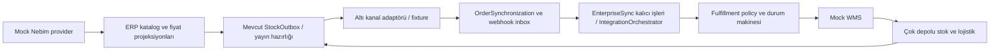

# MarketPilot proje denetimi

30 Ekim 2026 · HEAD `b787731` · Windows / .NET SDK 8.0.427, runtime 8.0.33 / Node 24.22.1 / Chrome 156.0.8078.74

Karar: **canlı faz için NO-GO**. Yerel mock geliştirme ve hata düzeltme devam edebilir. Uygulama kaynakları bu denetimde düzeltilmedi; yalnız test altyapısı ve bu raporlar eklendi. Önceden değişmiş dosyalar korundu.

## Kapsam ve kanıtın sınırı

Güncel dosyalar, derleme, fixture testleri ve izole süreçler esas alındı; eski raporlar sonuç kaynağı olarak kullanılmadı. 173 uygulama dosyası, 16,809 kaynak satırı, 480 tür bildirimi, 194 endpoint bildirimi, 12 route grubu; mevcut 24 console test projesi ve 36 üst seviye kontrol betiği envanteri çıkarıldı. Tür sayısı partial tanımları da içerir. Endpoint sayısı dinamik Trendyol işlem kataloğunu ve genişleyen route kombinasyonlarını ayrı endpoint olarak saymaz.

**Durumlar:** Tamamlandı = belirtilen yerel kapsam doğrulandı; Kısmi = akışın yalnız bir bölümü; Demo = mock/fixture; Eksik = mevcut değil; Hatalı = tekrar üretildi; Doğrulanmadı = test edilmedi. Tamamlandı, canlı sağlayıcı sertifikasyonu anlamına gelmez.

173 dosyanın tamamı dosya/tür/endpoint/işaret envanterinde yer alır. Modül kaynakları iş kuralları ve test kanıtlarıyla birlikte incelendi. Bu, her satır için biçimsel doğrulama veya her endpoint × rol × payload kombinasyonu testi değildir. Bu kombinasyonların tümüne kapsam verilemedi; doğrulanmayanlar aşağıdaki raporlarda açıkça belirtilir.

## Mimari

ASP.NET Core 8 tek web projesi ve DI servisleri; statik HTML/CSS/JavaScript, frontend framework yok. Kalıcılık tenant klasörlerine ayrılmış JSON dosyaları; ilişkisel DB/EF/Npgsql yok. Servisler process içi lock/semaphore ve dosya değişimi kullanıyor. DataDirectoryLock aynı veri klasörünü ikinci süreçte açmayı engelliyor. Bu yapı yerel tek süreç içindir; yatay ölçek ve çok servisli işlem garantisi olarak sunulamaz.

Şema hedef bağımlılıkları gösterir; her ok canlı veya tam atomik değildir. Özellikle fulfillment tahsisleri ortak rezervasyon defterine bağlanmadığı için MP-QA-001 mevcut.

## Klasörler ve sorumluluklar

| Alan | Gerçek rol / durum |
| --- | --- |
| src/MarketPilot.Web/Program.cs | DI, middleware sırası, temel ürün/sipariş/ayar/export/health uçları |
| Catalog | ERP salt okunur katalog, fark/uygulama, mevcut ilan eşleştirmesi, kategori ve ürün sahipliği |
| Contracts | 17 ortak model, kimlik/sürüm/idempotency, manuel eşleştirme ve türetilmiş ATS |
| Enterprise/Nebim | INebimErpProvider ve MockNebimProvider; yerel uygulama API’leri; native Nebim adaptörü yok |
| Enterprise | Mevcut bridge, plan/zamanlayıcı, kalıcı iş, orchestrator, ERP aktarım hazırlığı ve izleme |
| Pricing | Yetkili ERP listesi, KDV/para birimi/masraf/kampanya/onay/preview; gerçek fiyat gönderimi engelli |
| Wms | Bağımsız provider sözleşmesi, mock, çok depo, fulfillment, sevkiyat/iade/etiket yetkisi |
| Integrations | Altı native adaptör, kimlik profilleri, ortak mapper/capability; demo sağlayıcıları ve central-stock |
| Synchronization / Webhooks | Sipariş okuyucu, kalıcı StockOutbox, imzalı inbox ve worker |
| Local | Cookie/rol/tenant, SSRF/DNS hedef koruması, dosya erişimi, log masking, yedek ve recovery |
| Workspace / Analytics | Yerel operasyon talepleri, belge/refund taslakları, rapor, maliyet, aktivite |
| wwwroot/assets | 30 JS dosyası; render fonksiyonlarının katmanlı override’ları, tablo/filtre/formlar |
| tests | 23 Checks projesi + WorkerIsolationAudit, 36 mevcut betik; tests/qa denetim testleri |
| .github/workflows / Dockerfile / compose.yaml / Caddyfile | CI tanımı ve TLS/reverse proxy dağıtım hazırlığı; gerçek deploy yapılmadı |

## Mimari sorunlar ve sadeleştirme

- **Birden çok stok/rezervasyon temsili:** CanonicalStore, OperationalInventory, central-stock, WmsInventoryService ve FulfillmentOrchestration farklı yollar. Birinin lock testinin geçmesi diğerini güvenli yapmıyor (MP-QA-001).
- **İki IWmsProvider:** Enterprise/EnterpriseProviders.cs:8 mevcut özel bridge; Wms/Contracts.cs bağımsız provider. Namespace ayrımı derlemeyi sağlıyor; isim ve yetenek sınırı bakım maliyetini artırıyor. Adaptasyon ve tek tahsis otoritesi gerekli.
- **Kuyruklar:** orchestrator ikinci paralel yürütücü kurmuyor, EnterpriseSync işlerini kullanıyor. Sistemde önceden bulunan webhook inbox, stock outbox ve demo jobs farklı amaçlarla yaşamaya devam ediyor. Uçtan uca atomiklik ayrı JSON dosyaları arasında yok; idempotency/uzlaştırmayla yönetiliyor.
- **Frontend override zinciri:** app.js, catalog, listing-filters, operations, analytics, workflow ve WMS modülleri global fonksiyonları değiştiriyor. Eski seçicilere bağlı 3 UI paketi bu yüzden duruyor. Modül router ve ortak event/modal katmanı önerilir.
- **JSON maliyeti:** tam snapshot/serileştirme ve process içi kilitler; arşivleme/retention ve büyük kuyruk/rapor indeksi üretim ölçeğinde doğrulanmış değil.
- **Audit:** tenant kontrollü işlem izleri ve maskelenmiş olaylar var; değiştirilemez harici audit, metrik/alert SLO ve DR tatbikatı üretim fazına kalıyor.

## Gereksiz / eski alanlar

app.js eski placeholder, openBarcode, yerel shipping/listing fonksiyonları taşıyor; sonraki JS dosyaları birçok aktif ekranı override ediyor. Bunlar statik adaylardır: dış tüketici/çalışma anı referansı ölçülmeden “tamamen kullanılmıyor” denilip silinmemeli. Program.cs eski ürün yazma route’ları kasıtlı 405/409 uyumluluk koruması; gereksiz endpoint değildir. Doğrudan UI çağrısı olmayan provider, webhook ve worker API’leri de dış/internal kullanım nedeniyle ölü kod sayılmadı.

Tek literal TODO: Nebim/Contracts.cs:17, doğrulanmış native adaptör sözleşmesini bekliyor. Kaynak taramasında literal FIXME/HACK/NotImplementedException bulunmadı. Bu sayı işlevsel eksik olmadığı anlamına gelmez; capability/NotSupported ve mock alanları ayrıca değerlendirildi.

## Kanıtlar

- [evidence/inventory.json](evidence/inventory.json): bütün dosyalar, türlerin file:line listesi, route bildirimleri, JS API literalleri ve test projeleri.
- [evidence/source-baseline.json](evidence/source-baseline.json) / [evidence/source-final.json](evidence/source-final.json): HEAD, başlangıç çalışma ağacı ve SHA-256 karşılaştırması. Kaynak değişimi: **0**.
- [evidence/static-analysis.json](evidence/static-analysis.json), [evidence/test-results.json](evidence/test-results.json), [özellik matrisi](FEATURE_MATRIX.md), [hata kaydı](BUG_REGISTER.md).

Testin ürettiği üç resilience PNG’si evidence/resilience altında saklandı; başlangıçta temiz olan artifacts/resilience dosyaları eski baytlarına geri kondu. Kullanıcı veri klasörleri açılmadı/değiştirilmedi. Üretim veya ana uygulama servisi başlatılmadı; yalnız geçici test süreçleri çalıştırıldı.
